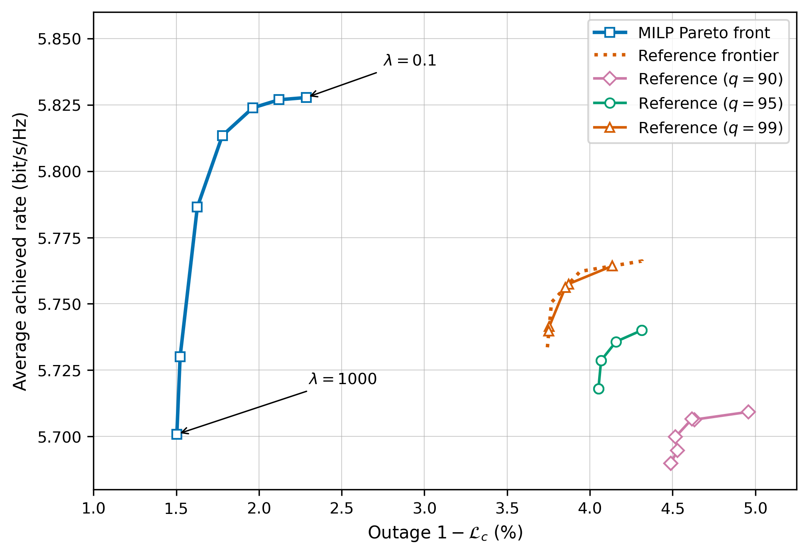

# MILP-based Optimal Handover Decisions: A Benchmark for Mobility Management Algorithms [1]

## Description
This repository accompanies the paper *MILP-Based Optimal Handover Decisions: A Benchmark for Mobility Management Algorithms* [1]. It optimizes serving-cell assignments for recorded network trajectories using a mixed-integer linear program (MILP). The objective balances average achieved rate against time spent disconnected, producing a rate-outage Pareto frontier across different trade-off weights.

The formulation includes handover execution and key radio resource control (RRC) mechanisms: N310/N311 counters, the T310 timer, and radio link failure (RLF) recovery. An A3 event-based reference simulation provides a baseline for comparing handover policies on the same trajectories. The [published IEEE DataPort dataset](https://dx.doi.org/10.21227/9zk6-vb30) contains the network measurements, MILP decisions, and reference results used in the paper; the commands below run individual cases and recreate the comparison plots.

The figure shows the rate-outage trade-off for the published 60 km/h trajectories, including the MILP frontier and A3 reference curves for three quantile selections.



---

## Installation
To install the handover-optim-milp package, follow these steps:

1. Clone the repository:
    ```bash
    git clone https://github.com/kit-cel/handover-optim-milp
    ```

2. Navigate to the project directory:
    ```bash
    cd handover-optim-milp
    ```

3. Install the package:
    ```bash
    python -m pip install .
    ```
    i.e., to install it in editable mode/develop mode:
    ```bash
    python -m pip install -e .
    ```

You are now ready to use the handover-optim-milp framework for your projects.

---

## Getting Started
### **Get the Dataset**
Download the [published dataset](https://dx.doi.org/10.21227/9zk6-vb30) and extract the archive into the repository directory. The resulting `dataset_root/` directory must contain `network_data/`, `milp_results/`, and `reference_results/`.

The dataset and detailed per-UE results are hosted on IEEE DataPort rather than in this repository because of their size. Results generated with this release may differ from stored per-step binary flags and handover counts where the original export truncated solver values just below an integer.

### Run the MILP Optimization and the RRC Reference Simulation
1. **Run the optimization**:
   ```bash
   python -m ho_optim_milp.run run_optimization --ep-idx=0 --ue-idx=0
   ```
   where `--ep-idx` specifies the episode (0-5) of the dataset and `--ue-idx` defines the UE trajectory that should be used (0-99).
2. **Run the RRC reference simulation**:
   ```bash
   python -m ho_optim_milp.run run_reference --ep-idx=0
   ```
   where `--ep-idx` specifies the episode (0-5) of the dataset. The reference simulation is automatically performed for all UEs in the dataset.

### Results
You can plot the results stored in the dataset and reproduce the figures in [1] using the included plotting functionality.

1. **Plot the rate-outage Pareto fronts of the optimization and the reference.**:
   ```bash
   python -m ho_optim_milp.run plot_pareto_fronts
   ```

2. **Plot the trade-off between the mean achieved rate and the relative connected time versus the Lagrangian multiplier lambda.**:
   ```bash
   python -m ho_optim_milp.run plot_tradeoff
   ```

## Citation [1]
If you use the **handover-optim-milp** framework in your work, please cite our paper:
```
@ARTICLE{11554293,
  author={Voigt, Johannes and Rost, Peter M.},
  journal={IEEE Communications Letters}, 
  title={{MILP}-Based Optimal Handover Decisions: A Benchmark for Mobility Management Algorithms}, 
  year={2026},
  volume={30},
  number={},
  pages={2193-2197},
  doi={10.1109/LCOMM.2026.3701321}}

```

## **License**
This project is licensed under the MIT License. See the [LICENSE](./LICENSE) file for details.

