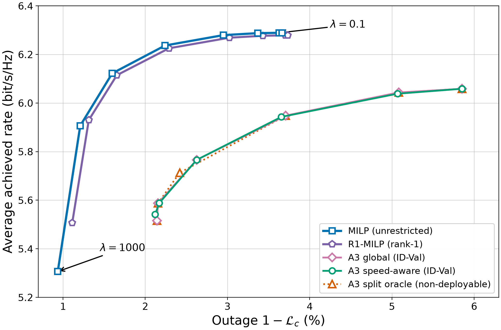

# Handover optimization with MILP

Optimize stored `network_data` trajectories with MILP, run A3 and no-handover
references, and generate metrics and figures. A3 uses the RRC in
[`mobile-network-sim`](https://github.com/kit-cel/mobile-network-sim); no new
radio simulation is needed for stored data. `unrestricted` and `binary_rank1`
use one MILP implementation.

The [v1.0.0 release](https://github.com/kit-cel/handover-optim-milp/releases/tag/v1.0.0)
preserves the code for the [paper](https://doi.org/10.1109/LCOMM.2026.3701321)
and [published dataset](https://dx.doi.org/10.21227/9zk6-vb30). Current
development uses schema 3.



## Install

```bash
python -m pip install -e .
```

Installation includes the tagged `mobile-network-sim` GitHub release.

## Use stored network data

```bash
ho-optim optimize --network-data /path/to/id_val.h5 \
  --config config/optimization_config.yaml --episode-index 0 --ue-index 0 \
  --max-steps 20 --output-dir /path/to/optimization

ho-optim run-a3 --network-data /path/to/id_val.h5 \
  --config config/reference_config.yaml --episode-index 0 \
  --max-steps 20 --output-dir /path/to/a3
```

`--max-steps` limits local checks to a trajectory prefix.

## Build and inspect a dataset

```bash
ho-optim build-dataset --network-data id_val=/path/to/id_val.h5 \
  --config config/optimization_config.yaml \
  --a3-config config/reference_config.yaml --selection-split id_val \
  --lambda 0.0 --lambda 1.0 --output-root /path/to/dataset

ho-optim validate-dataset --dataset-root /path/to/dataset
ho-optim plot-dataset --dataset-root /path/to/dataset \
  --split id_val --output-root /path/to/plots
```

Repeat `--network-data` for more splits and `--a3-config` for more A3 profiles.
Use `--a3-search` with one A3 template profile for the coarse-to-fine search.
The plot command reads saved results and writes outside the dataset. Use
`--max-steps` with `optimize` or `run-a3` for small local checks.

## Citation

```bibtex
@ARTICLE{11554293,
  author={Voigt, Johannes and Rost, Peter M.},
  journal={IEEE Communications Letters},
  title={{MILP}-Based Optimal Handover Decisions: A Benchmark for Mobility Management Algorithms},
  year={2026},
  volume={30},
  pages={2193-2197},
  doi={10.1109/LCOMM.2026.3701321}}
```

MIT licensed; see [LICENSE](LICENSE).
